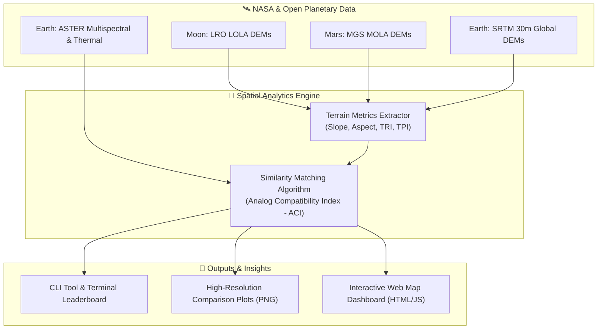

# 🚀 PTAE: Planetary Terrestrial Analog Engine
### *Quantitative Identification and Characterization of Earth Analogs for Moon and Mars Base Locations*
**NASA International Space Apps Challenge 2026**

[](https://www.spaceappschallenge.org/)
[](LICENSE)
[](https://www.python.org/)
[](dashboard/index.html)

---

## 📌 Project Overview
Selecting future landing sites and permanent base camps on the **Moon (Artemis III Lunar South Pole)** and **Mars** requires testing rovers, habitats, spacesuits, and In-Situ Resource Utilization (ISRU) systems in real-world extreme environments on Earth. 

While terrestrial analogs like the Atacama Desert or Haughton Crater are well known, they have historically been selected using qualitative assumptions. **PTAE (Planetary Terrestrial Analog Engine)** provides an automated, data-driven framework, modeled on open elevation data from NASA (**LOLA**, **MOLA**, **SRTM**) and ESA, to mathematically identify, evaluate, and characterize new terrestrial analogs.

> **Data note:** The default `python main.py` run uses high-fidelity **procedural DEMs** (`src/synthetic_generator.py`) calibrated to match published morphometric parameters (slope, relief, crater/caldera geometry) for each real site, so the full pipeline runs instantly with zero downloads. `scripts/download_nasa_samples.py` fetches real LOLA/HiRISE/SRTM GeoTIFF tiles for the same locations — swap them into `data/` and the identical `terrain_metrics` → `similarity_matcher` pipeline runs unchanged on real satellite data.

---

## 🏗️ Architecture & Workflow



---

## 🏆 Key Findings
*(reproduced by `python main.py --target moon` / `--target mars`, ranked out of 5 candidate sites)*

| Extraterrestrial Target | Top Earth Analog Found | ACI Score | Key Matching Factors |
| :--- | :--- | :--- | :--- |
| **Moon (Artemis South Pole)** | **McMurdo Dry Valleys, Antarctica** | **84.9%** | Steep katabatic-carved slopes and high small-scale ruggedness (TRI) matching lunar highland micro-roughness; Askja Caldera, Iceland is a close #2 (77.8%) via basaltic lava-tube shielding. |
| **Mars (Jezero Crater)** | **Mauna Kea Cinder Cones, Hawaii** | **100.0%** | Basaltic tephra slopes and pyroclastic cone ruggedness closely mirror Jezero's crater-rim/delta relief; Puna de Atacama, Chile is #2 (89.8%) via hyper-arid, high-altitude terrain. |

---

## ⚡ Quickstart Guide

### 1. Clone & Set Up Python Environment
```bash
git clone https://github.com/your-team/nasa-space-apps-2026.git
cd "nasa-space-apps-2026"

# Create and activate virtual environment
python3 -m venv venv
source venv/bin/activate

# Install requirements
pip install -r requirements.txt
```

### 2. Run the Analog Matching Pipeline
Run the full analysis for the Moon:
```bash
python main.py --target moon
```
Or evaluate Mars Jezero Crater:
```bash
python main.py --target mars
```

This will automatically:
1. Generate / load high-resolution planetary and candidate DEMs in `data/`.
2. Compute **Slope**, **Aspect**, and **Terrain Ruggedness Index (TRI)**.
3. Compute the **Analog Compatibility Index (ACI)** across all candidate sites.
4. Output high-resolution figures into `results/`:
   - `target_terrain_suite.png`
   - `top_analog_terrain_suite.png`
   - `analog_compatibility_leaderboard.png`
   - `analog_radar_comparison.png`

---

## 🌐 Interactive Web Dashboard
You can explore the global candidate analog sites on an interactive Leaflet map!

Simply open **`dashboard/index.html`** in any web browser:
```bash
# On Linux:
xdg-open dashboard/index.html

# Or start a simple local server:
python -m http.server 8000
# Then visit http://localhost:8000/dashboard/
```

Features:
- Switch between **Moon (Artemis III Pole)** and **Mars (Jezero Crater)**.
- Click candidate pins (Iceland, Atacama, Antarctica, Devon Island, Hawaii) for real-time quantitative breakdowns.
- Interactive multi-parameter radar chart powered by Chart.js.
- 3D terrain viewer, mission weight "what-if" calculator, and a NASA data/mission science reference tab.
- The map/leaderboard tab always shows the real ACI scores computed by `main.py` (kept in sync with `results/summary.json`); the Weight Calculator tab is a separate "what-if" explorer that re-weights the same underlying signatures.

### Deploying it as a public site
`dashboard/index.html` is a fully static, single-file, zero-build app (all dependencies load from CDN), so it can be hosted anywhere that serves static files — no server-side code or build step required:
- **GitHub Pages:** enable Pages on this repo pointing at the `dashboard/` folder (or copy `index.html` to your Pages branch).
- **Netlify / Vercel / Cloudflare Pages:** drag-and-drop the `dashboard/` folder, or set the publish directory to `dashboard`.
- **Any static host / S3 / nginx:** just copy `dashboard/index.html` — there's nothing else to build or configure.

It's responsive down to mobile widths and degrades gracefully (with an on-screen notice) if a browser doesn't support WebGL for the 3D tab.

---

## 📂 Project Structure
```text
.
├── dashboard/
│   └── index.html               # Zero-dependency interactive web map & radar explorer
├── data/                        # Planetary and terrestrial DEM datasets (.npy or .tif)
├── docs/
│   ├── PITCH_DECK_GUIDE.md      # 7-slide presentation script & 30-second pitch
│   └── SCIENTIFIC_METHODOLOGY.md# In-depth geological & topographic justification
├── results/                     # Generated PNG heatmaps, radar plots, and summary.json
├── src/
│   ├── __init__.py
│   ├── terrain_metrics.py       # Slope, TRI, TPI, and elevation variance algorithms
│   ├── similarity_matcher.py    # Analog Compatibility Index (ACI) scoring logic
│   ├── synthetic_generator.py   # Procedural simulator for planetary and terrestrial DEMs
│   └── visualizer.py            # Matplotlib plotting routines and JSON exporter
├── main.py                      # Unified CLI entrypoint
├── NASA_SPACE_APPS_SUBMISSION.md# Official Space Apps project submission document
├── requirements.txt             # Project dependencies
├── LICENSE                      # MIT Open Source License
└── README.md                    # Project landing page
```

---

## 🛰️ Open Data Sources
- **NASA PDS Geosciences:** Lunar Orbiter Laser Altimeter (LOLA) & Mars Orbiter Laser Altimeter (MOLA)
- **NASA Earthdata Search:** Shuttle Radar Topography Mission (SRTM) & ASTER GDEM
- **USGS Astrogeology:** Planetary GIS and QuickMap LROC datasets

---

## 📜 License
Distributed under the **MIT License**. See `LICENSE` for details.
