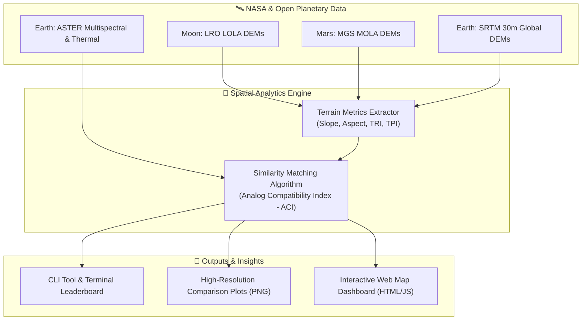

# 🚀 PTAE: Planetary Terrestrial Analog Engine
### *Quantitative Identification and Characterization of Earth Analogs for Moon and Mars Base Locations*
**NASA International Space Apps Challenge 2026**

[](https://www.spaceappschallenge.org/)
[](LICENSE)
[](https://www.python.org/)
[](dashboard/index.html)

---

## 📌 Project Overview
Selecting future landing sites and permanent base camps on the **Moon (Artemis III Lunar South Pole)** and **Mars** requires testing rovers, habitats, spacesuits, and In-Situ Resource Utilization (ISRU) systems in real-world extreme environments on Earth. 

While terrestrial analogs like the Atacama Desert or Haughton Crater are well known, they have historically been selected using qualitative assumptions. **PTAE (Planetary Terrestrial Analog Engine)** provides an automated, data-driven framework, modeled on open elevation data from NASA (**LOLA**, **MOLA**, **SRTM**) and ESA, to mathematically identify, evaluate, and characterize new terrestrial analogs.

> **Data note:** The default `python main.py` run uses calibrated **procedural DEMs** (`src/synthetic_generator.py`) based on published morphometric parameters for the modeled sites, so the pipeline runs without downloads. The downloader provides sample planetary and Earth GeoTIFFs; see [Limitations & Future Work](#limitations--future-work) for the current constraints on running real DEMs through the pipeline.

---

## 🏗️ Architecture & Workflow



---

## 🏆 Demo Rankings (Synthetic Terrain)
*(reproduced by `python main.py --target moon --json-out` / `python main.py --target mars --json-out`, ranked out of 5 candidate sites)*

| Extraterrestrial Target | Top Earth Analog Found | ACI Score | Key Matching Factors |
| :--- | :--- | :--- | :--- |
| **Moon (Artemis South Pole)** | **McMurdo Dry Valleys, Antarctica** | **82.52%** | Top-ranked of 5 candidates; Askja & Holuhraun Caldera, Iceland is #2 at **74.05%**. |
| **Mars (Jezero Crater)** | **Mauna Kea Cinder Cones, Hawaii** | **96.98%** | Top-ranked of 5 candidates; Puna de Atacama, Chile is #2 at **84.98%**. |

The Moon target is the lunar south pole region, not a specific Artemis III landing site.

## Real-Data Validation
The demo rankings above come from calibrated synthetic terrain. As a validation, we ran the same pipeline with real data: the Moon target from an LRO LOLA 20 m south-polar DEM, centered on the pole in 5, 10, and 15 km windows, and Askja from AWS Terrain Tiles (composite, approximately 30 m); the other four Earth candidates remain synthetic.

| Candidate | 5 km Rank | 5 km Final ACI | 10 km Rank | 10 km Final ACI | 15 km Rank | 15 km Final ACI |
| :--- | ---: | ---: | ---: | ---: | ---: | ---: |
| Askja & Holuhraun Caldera, Iceland | 1 | 70.24% | 4 | 63.60% | 4 | 57.06% |
| Mauna Kea Cinder Cones | 2 | 52.80% | 1 | 87.48% | 2 | 84.98% |
| Puna de Atacama | 3 | 51.86% | 2 | 84.46% | 1 | 89.22% |
| Haughton Impact Crater, Devon Island | 4 | 47.81% | 3 | 65.94% | 3 | 81.86% |
| McMurdo Dry Valleys | 5 | 36.77% | 5 | 36.25% | 5 | 46.36% |

The top candidate changes with window size: Askja at 5 km, Mauna Kea at 10 km, and Atacama at 15 km. McMurdo ranks last in all three windows, while Mauna Kea and Atacama remain in the top three throughout. The ACI is scale-sensitive in this comparison.

Only the Moon target and Askja change with window size; the other four candidates are fixed synthetic DEMs. Some of the observed sensitivity therefore comes from resolution and scale mismatch, not only from terrain.

Next, use real DEMs for every candidate at one common ground resolution and window size. Mars requires HiRISE or CTX data because MOLA at 463 m/pixel is too coarse for a like-for-like comparison with 30 m Earth data; our test at approximately 334 m/pixel produced near-zero slope congruence.

## Scoring Method
The base ACI is a weighted average of Gaussian similarity scores for five terrain metrics, scaled to 0-100. An additive environmental bonus of up to 5 points is applied for three boolean flags: hyper-arid, basaltic, and lava-tube geology. Each matching flag contributes one third of the maximum bonus (about 1.67 points). Scores are capped below 100 unless the weighted terrain metrics are an exact match.

Use `--json-out` to export ranked scores and terrain details to `dashboard/results_<target>.json`; for example, the Moon and Mars commands below write `results_moon.json` and `results_mars.json` in `dashboard/`.

## Limitations & Future Work
The default run uses calibrated synthetic DEMs, not measurements from LOLA, MOLA, or SRTM. The reported rankings are therefore results for those generated terrain inputs and the current scoring model, not validation of real-world mission-site suitability.

To prepare a real-data run, download and preprocess LOLA data for the Moon target, MOLA data for the Mars target, and SRTM data for the Earth candidates. Clip and align each DEM, handle its no-data values, and convert it to a NumPy array using the expected names in `data/`: `target_moon_artemis_south_pole.npy`, `target_mars_jezero_crater.npy`, and `earth_iceland_askja.npy`, `earth_atacama_puna.npy`, `earth_mcmurdo_dry_valleys.npy`, `earth_haughton_crater.npy`, and `earth_hawaii_mauna_kea.npy`. The current CLI regenerates these procedural arrays on every run, so replacing the files alone will not use real data. Future work is to add a real-input path that skips generation and validates these prepared DEMs before running the existing metrics and scoring pipeline.

---

## ⚡ Quickstart Guide

### 1. Clone & Set Up Python Environment
```bash
git clone https://github.com/your-team/nasa-space-apps-2026.git
cd "nasa-space-apps-2026"

# Create and activate virtual environment
python3 -m venv venv
source venv/bin/activate

# Install requirements
pip install -r requirements.txt
```

### 2. Run the Analog Matching Pipeline
Run the full analysis for the Moon:
```bash
python main.py --target moon --json-out
```
Or evaluate Mars Jezero Crater:
```bash
python main.py --target mars --json-out
```

This will automatically:
1. Generate / load high-resolution planetary and candidate DEMs in `data/`.
2. Compute **Slope**, **Aspect**, and **Terrain Ruggedness Index (TRI)**.
3. Compute the **Analog Compatibility Index (ACI)** across all candidate sites.
4. Output high-resolution figures into `results/`:
   - `target_terrain_suite.png`
   - `top_analog_terrain_suite.png`
   - `analog_compatibility_leaderboard.png`
   - `analog_radar_comparison.png`

---

## 🌐 Interactive Web Dashboard
You can explore the global candidate analog sites on an interactive Leaflet map!

From the repository root, generate both target result files and start the local server:
```bash
python main.py --target moon --json-out
python main.py --target mars --json-out
python -m http.server
```
Then open http://localhost:8000/dashboard/.

Features:
- Switch between **Moon (Artemis III Pole)** and **Mars (Jezero Crater)**.
- Click candidate pins (Iceland, Atacama, Antarctica, Devon Island, Hawaii) for real-time quantitative breakdowns.
- Interactive multi-parameter radar chart powered by Chart.js.
- 3D terrain viewer, mission weight "what-if" calculator, and a NASA data/mission science reference tab.
- The map and leaderboard use the scores loaded from `dashboard/results_moon.json` and `dashboard/results_mars.json`; the Weight Calculator tab is a separate "what-if" explorer that re-weights the same underlying signatures.

### Moon and Mars target-site catalogue
`dashboard/target_sites.json` is the shared source for the dashboard's approximate Moon and Mars target regions and qualitative Earth-analog matches. Each target record includes its body, approximate latitude/longitude, short description, key features, mission relevance, and source note; each match lists shared features and its body-specific display order. The match order is qualitative demo data, not an ACI score or a change to the scoring model.

Every target record sets `coords_approximate` to `true`. Verify its coordinates and regional context against NASA/USGS mission cartography before scientific or mission use. When `main.py --target moon --json-out` or `main.py --target mars --json-out` writes a result file, it also includes that body's target-site records and qualitative mappings; the existing terrain metrics and ACI scores are unchanged.

### Deploying it as a public site
The dashboard is a static, zero-build app (dependencies load from CDN), so the full `dashboard/` directory can be hosted anywhere that serves static files. Keep `target_sites.json`, `results_moon.json`, `results_mars.json`, imagery assets, and `index.html` together; the page fetches these local files at runtime.
- **GitHub Pages:** enable Pages on this repo pointing at the `dashboard/` folder. Keep the JSON result files, target-site catalogue, and referenced assets alongside `index.html`.
- **Netlify / Vercel / Cloudflare Pages:** drag-and-drop the `dashboard/` folder, or set the publish directory to `dashboard`.
- **Any static host / S3 / nginx:** just copy `dashboard/index.html` — there's nothing else to build or configure.

It's responsive down to mobile widths and degrades gracefully (with an on-screen notice) if a browser doesn't support WebGL for the 3D tab.

---

## 📂 Project Structure
```text
.
├── dashboard/
│   └── index.html               # Zero-dependency interactive web map & radar explorer
├── data/                        # Planetary and terrestrial DEM datasets (.npy or .tif)
├── docs/
│   ├── PITCH_DECK_GUIDE.md      # 7-slide presentation script & 30-second pitch
│   └── SCIENTIFIC_METHODOLOGY.md# In-depth geological & topographic justification
├── results/                     # Generated PNG heatmaps, radar plots, and summary.json
├── src/
│   ├── __init__.py
│   ├── terrain_metrics.py       # Slope, TRI, TPI, and elevation variance algorithms
│   ├── similarity_matcher.py    # Analog Compatibility Index (ACI) scoring logic
│   ├── synthetic_generator.py   # Procedural simulator for planetary and terrestrial DEMs
│   └── visualizer.py            # Matplotlib plotting routines and JSON exporter
├── main.py                      # Unified CLI entrypoint
├── NASA_SPACE_APPS_SUBMISSION.md# Official Space Apps project submission document
├── requirements.txt             # Project dependencies
├── LICENSE                      # MIT Open Source License
└── README.md                    # Project landing page
```

---

## 🛰️ Open Data Sources
- **NASA PDS Geosciences:** Lunar Orbiter Laser Altimeter (LOLA) & Mars Orbiter Laser Altimeter (MOLA)
- **NASA Earthdata Search:** Shuttle Radar Topography Mission (SRTM) & ASTER GDEM
- **USGS Astrogeology:** Planetary GIS and QuickMap LROC datasets

---

## 📜 License
Distributed under the **MIT License**. See `LICENSE` for details.
