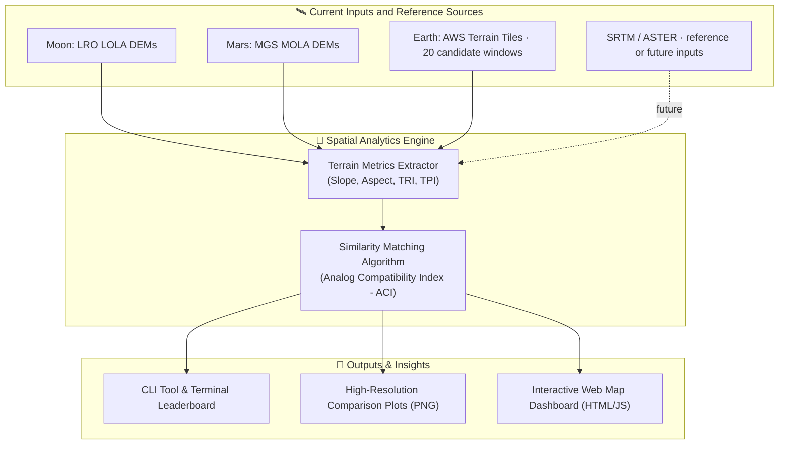

> **PTAE:** A prototype for comparing Earth terrain statistics with Moon and Mars targets.
> **Inputs:** 20 real-DEM Earth candidates, with LOLA/MOLA target DEMs.
> **Current leaders:** Moon: Teide; Mars: Kilauea.
> **Caveat:** Prototype heuristic; tests terrain morphology only, not geology or mission suitability.

**How to read the results:** ACI is a heuristic similarity score, not a measure of mission suitability. The Moon leader is stable under the tested weight changes; the Mars leader is weight-sensitive. Stability describes the chosen scenario mix, not scientific probabilities.

# 🚀 PTAE: Planetary Terrestrial Analog Engine
### *Quantitative Identification and Characterization of Earth Analogs for Moon and Mars Base Locations*
**NASA International Space Apps Challenge 2026**

[](https://www.spaceappschallenge.org/)
[](LICENSE)
[](https://www.python.org/)
[](dashboard/index.html)

---

## 📌 Project Overview
Selecting future landing sites and permanent base camps on the **Moon (Artemis III Lunar South Pole)** and **Mars** requires testing rovers, habitats, spacesuits, and In-Situ Resource Utilization (ISRU) systems in real-world extreme environments on Earth. 

While terrestrial analogs like the Atacama Desert or Haughton Crater are well known, they have historically been selected using qualitative assumptions. **PTAE (Planetary Terrestrial Analog Engine)** provides an automated framework for comparing DEM-derived terrain statistics. Its current real-data results use LRO LOLA for the lunar target, MOLA for Jezero, and AWS Terrain Tiles for 20 Earth candidates; SRTM, ASTER, and other sources are references or future inputs, not current Earth candidate DEMs.

> **Data note:** The default `python main.py` run still generates calibrated **procedural DEMs** (`src/synthetic_generator.py`) for a self-contained demo. The checked-in dashboard rankings were instead generated from the prepared real target and Earth DEMs in `data_real/`; the per-site source and resolution are recorded in JSON sidecars.

---

## 🏗️ Architecture & Workflow



---

## 🏆 Current Real-Data Rankings
*(from `dashboard/results_moon.json` and `dashboard/results_mars.json`; all 20 Earth candidate DEMs are AWS Terrain Tiles windows)*

| Extraterrestrial Target | Top Earth Analog Found | ACI Score | Key Matching Factors |
| :--- | :--- | :--- | :--- |
| **Moon (LRO LOLA south-polar target)** | **Teide / Tenerife Volcanic Field** | **87.22%** | #1 of 20 candidates; Mount Etna is #2 at **86.79%**. |
| **Mars (MOLA Jezero target)** | **Kilauea Volcanic Field** | **55.84%** | #1 of 20 candidates; Craters of the Moon, Idaho is #2 at **54.99%**. |

The Moon target is the lunar south-pole region, not a specific Artemis III landing site. These scores rank terrain-statistics similarity; they do not demonstrate mission suitability.

All 20 current Earth inputs are real AWS Terrain Tiles windows covering 10 km per side, resampled to 300×300 at approximately 33.3–33.5 m/pixel. The prepared lunar target is LRO LOLA (20 m source, 33.399998 m/pixel output); the Jezero target is MOLA (333.686104 m/pixel output).

## Historical Window Sensitivity
This separate historical validation is not the current 20-site ranking. It compares the lunar target across 5, 10, and 15 km windows using LOLA and Askja terrain from AWS Terrain Tiles; four of its five Earth candidates were synthetic and fixed across windows.

| Candidate | 5 km Rank | 5 km Final ACI | 10 km Rank | 10 km Final ACI | 15 km Rank | 15 km Final ACI |
| :--- | ---: | ---: | ---: | ---: | ---: | ---: |
| Askja & Holuhraun Caldera, Iceland | 1 | 70.24% | 4 | 63.60% | 4 | 57.06% |
| Mauna Kea Cinder Cones | 2 | 52.80% | 1 | 87.48% | 2 | 84.98% |
| Puna de Atacama | 3 | 51.86% | 2 | 84.46% | 1 | 89.22% |
| Haughton Impact Crater, Devon Island | 4 | 47.81% | 3 | 65.94% | 3 | 81.86% |
| McMurdo Dry Valleys | 5 | 36.77% | 5 | 36.25% | 5 | 46.36% |

The top candidate changed with window size in that historical run: Askja at 5 km, Mauna Kea at 10 km, and Atacama at 15 km. The table remains useful as evidence of window sensitivity, but it must not be presented as a current all-real ranking.

Only the Moon target and Askja changed with window size; the other four candidates were fixed synthetic DEMs. Some sensitivity therefore reflects resolution and scale mismatch, not only terrain.

## Weight Sensitivity
The full-window analysis in [dashboard/weight_sensitivity.json](dashboard/weight_sensitivity.json) covers 1,018 scenarios per target: baseline, ten one-at-a-time changes, equal weights, five drop-one cases, 1,000 Dirichlet(1,1,1,1,1) draws with seed 42, and a separate flag-bonus-off case. Teide remains Moon #1 in 945/1,018 scenarios (92.829077%) and top three in 1,018/1,018 (100%); Kilauea remains Mars #1 in 227/1,018 (22.298625%) and top three in 431/1,018 (42.337917%). Minimum/median Spearman versus baseline are 0.738346/0.968421 for Moon and -0.004511/0.678947 for Mars. These percentages include baseline and bonus-off; the JSON also provides random-only summaries and every leader-changing scenario. This tests robustness to weights, not scientific correctness of the weights or flags; the selected scenario mix is not a scientific probability distribution, and DEM scale mismatches remain. Both baseline orders and every ACI must match the protected ranking files exactly. Reproduce with `python -B scripts/weight_sensitivity.py`; it writes only the separate weight-sensitivity JSON, without changing defaults or existing rankings.

## Scoring Method
The base ACI is a weighted average of Gaussian similarity scores for five terrain metrics, scaled to 0-100. An additive environmental bonus of up to 5 points is applied for three boolean flags: hyper-arid, basaltic, and lava-tube geology. Each matching flag contributes one third of the maximum bonus (about 1.67 points). Scores are capped below 100 unless the weighted terrain metrics are an exact match.

Use an explicit `--json-out PATH` to export ranked scores and terrain details. Only the real-data reproduction commands below target `dashboard/results_<target>.json`; synthetic-demo exports belong in `results_synthetic_demo/`.

## Limitations & Future Work
The default CLI mode still regenerates procedural DEMs in `data/`; it does not use the checked-in real-data rankings. The 15 added catalog coordinates and analog flags are approximate and require manual verification. The terrain ACI ranks statistical similarity only; it does not prove mission suitability.

- **Resolution mismatch:** Mars is approximately 334 m/pixel versus approximately 33 m/pixel for the Earth candidates. Terrain metrics depend on resolution, so Mars scores are indicative and not directly comparable.
- **Catalog uncertainty:** The 15 added sites' coordinates and flags are approximate; verify them manually before scientific or operational use.
- For 14 of the 15 added Earth sites, AWS DEMs were upsampled from ~55.5-76.2 m/pixel to ~33 m/pixel; Svalbard was downsampled from 15.65 to 33.34 m/pixel. Upsampling does not add terrain detail. The Mars grid was resampled from ~451 to ~334 m/pixel and spans ~100 km per side, versus ~10 km for Earth windows. Flags on added sites are unverified. DEM metrics check terrain morphology only, not geology.
- **Qualitative mappings:** `dashboard/target_sites.json` includes provisional mappings for added sites, based on catalog descriptions and existing DEM metrics; mappings are separate from the 20-site ACI ranking.
- **Historical validation:** `dashboard/window_sensitivity.json` preserves the historical analysis with four synthetic Earth candidates and one real Askja candidate, and includes a separate 20-site real-DEM center-crop sensitivity analysis for Moon and Mars. Crops keep pixel resolution fixed as the physical window shrinks; they are not a validation of the full-window ranking.
- **Calculator:** The dashboard Mission Weight Calculator is a heuristic scenario model, not the Python ACI.
- **Interpretation:** Rankings describe terrain-statistics similarity, not proof that a site is safe, representative, or suitable for a mission.

The new sensitivity analysis covers only center crops of the existing window (no larger windows); mappings for added sites are provisional; the default synthetic demo and legacy `results.json` cover only the original five sites.

## Real-Data Reproduction (20 Sites)
These optional maintainer commands regenerate the current real-data ranking files; do not run them during a wording-only cleanup. From the repository root, install Rasterio if it is not already available (it is required by the fetch/preparation scripts but is excluded from `requirements.txt` on Windows), fetch or resume all 20 AWS Terrain Tiles site windows, then regenerate both current result files:

```bash
python -m pip install rasterio
python scripts/fetch_site_dems.py
python main.py --target moon --use-existing-data --data-dir data_real --no-vis --json-out dashboard/results_moon.json
python main.py --target mars --use-existing-data --data-dir data_real --no-vis --json-out dashboard/results_mars.json
cd dashboard
python -m http.server 8000
```

Open `http://localhost:8000`. The fetcher writes one `.npy` and JSON sidecar per Earth catalog site under `data_real/`; the target DEMs and their sidecars are prepared separately and are already included in this checkout.

### Real-DEM Crop Sensitivity (Existing Windows Only)
From the repository root, the following optional command updates the separate real-DEM sensitivity block using only centered 300/225/150 px crops of existing arrays. It preserves the historical block and does not change the Moon/Mars ranking files. It does not test larger windows or equalize physical footprints or pixel resolution. This command is documented here, not executed as part of this cleanup.

```bash
python -B scripts/window_sensitivity.py --real-dem-only --data-dir data_real
```

---

## ⚡ Quickstart Guide

### 1. Clone & Set Up Python Environment
```bash
git clone https://github.com/your-team/nasa-space-apps-2026.git
cd "nasa-space-apps-2026"

# Create and activate virtual environment
python3 -m venv venv
source venv/bin/activate

# Install requirements
pip install -r requirements.txt
```

### 2. Run the Analog Matching Pipeline
**Warning: this quickstart is a separate five-site synthetic illustration, not the current 20-site real-data dashboard.** Keep its inputs and outputs isolated; never use bare `--json-out` or a dashboard result path for a synthetic run.

Run the synthetic Moon illustration:
```bash
python main.py --target moon --data-dir data_synthetic_demo --output results_synthetic_demo/moon --json-out results_synthetic_demo/results_moon.json
```
Or run the synthetic Mars illustration:
```bash
python main.py --target mars --data-dir data_synthetic_demo --output results_synthetic_demo/mars --no-vis --json-out results_synthetic_demo/results_mars.json
```

These synthetic-demo commands will:
1. Generate procedural planetary and five candidate DEMs in `data_synthetic_demo/`.
2. Extract slope, **Terrain Ruggedness Index (TRI)**, TPI, and elevation statistics; Aspect is not computed by signature extraction.
3. Compute the **Analog Compatibility Index (ACI)** using five scored metrics: slope mean, slope standard deviation, TRI mean, TRI standard deviation, and elevation standard deviation. TPI is extracted but not scored.
4. Export synthetic JSONs into `results_synthetic_demo/` and Moon figures into `results_synthetic_demo/moon/` (the Mars example disables figures):
   - `target_terrain_suite.png`
   - `top_analog_terrain_suite.png`
   - `analog_compatibility_leaderboard.png`
   - `analog_radar_comparison.png`

---

## 🌐 Interactive Web Dashboard
The dashboard uses CesiumJS for its primary 3D globe, with a Leaflet fallback for Earth, plus Chart.js for the radar chart and Three.js for procedural terrain meshes. These libraries load from CDNs, so dashboard use requires internet access and an HTTP server; opening the HTML directly as a local file will prevent its JSON `fetch()` calls from working.

From the repository root, serve the checked-in 20-site real-data results without regenerating them:
```bash
python -m http.server
```
Then open http://localhost:8000/dashboard/.

Features:
- Switch between **Moon (Artemis III Pole)** and **Mars (Jezero Crater)**.
- Browse all Earth candidates from `data/sites.json` / `dashboard/sites.json`; keep these catalog files in sync.
- Click candidate pins for JSON-backed quantitative breakdowns and site provenance.
- Interactive multi-parameter radar chart powered by Chart.js.
- 3D terrain viewer, mission weight "what-if" calculator, and a NASA data/mission science reference tab.
- The map and leaderboard use scores loaded from `dashboard/results_moon.json` and `dashboard/results_mars.json`; the Weight Calculator is a separate "what-if" explorer. Keep `dashboard/sites.json` synchronized with `data/sites.json`, and refresh `dashboard/site_provenance.json` from the `data_real/` sidecars whenever Earth DEMs are fetched so the dashboard can read provenance when served from its own directory.

### Moon and Mars target-site catalogue
`dashboard/target_sites.json` is the shared source for the dashboard's approximate Moon and Mars target regions and qualitative Earth-analog matches. Each target record includes its body, approximate latitude/longitude, short description, key features, mission relevance, and source note; each match lists shared features and its body-specific display order. The match order is qualitative demo data, not an ACI score or a change to the scoring model.

Every target record sets `coords_approximate` to `true`. Verify its coordinates and regional context against NASA/USGS mission cartography before scientific or mission use. Ranked exports also include that body's target-site records and qualitative mappings; this metadata does not change terrain metrics or ACI scoring. Use the explicit real-data reproduction commands above when intentionally refreshing the dashboard results.

### Deploying it as a public site
The dashboard is a static, zero-build app, so the full `dashboard/` directory can be hosted anywhere that serves static files. Keep `target_sites.json`, `results_moon.json`, `results_mars.json`, imagery assets, and `index.html` together; the page fetches these local files at runtime. It needs internet access for its CDN libraries and remote imagery providers.
- **GitHub Pages:** enable Pages on this repo pointing at the `dashboard/` folder. Keep the JSON result files, target-site catalogue, and referenced assets alongside `index.html`.
- **Netlify / Vercel / Cloudflare Pages:** drag-and-drop the `dashboard/` folder, or set the publish directory to `dashboard`.
- **Any static host / S3 / nginx:** copy the complete `dashboard/` directory; there is no build step.

It's responsive down to mobile widths and degrades gracefully (with an on-screen notice) if a browser doesn't support WebGL for the 3D tab.

---

## 📂 Project Structure
```text
.
├── dashboard/
│   └── index.html               # Cesium globe, Earth Leaflet fallback, radar and 3D terrain explorer
├── data/                        # Planetary and terrestrial DEM datasets (.npy or .tif)
├── docs/
│   ├── PITCH_DECK_GUIDE.md      # 7-slide presentation script & 30-second pitch
│   └── SCIENTIFIC_METHODOLOGY.md# In-depth geological & topographic justification
├── results/                     # Generated PNG heatmaps, radar plots, and summary.json
├── src/
│   ├── __init__.py
│   ├── terrain_metrics.py       # Slope, TRI, TPI, and elevation variance algorithms
│   ├── similarity_matcher.py    # Analog Compatibility Index (ACI) scoring logic
│   ├── synthetic_generator.py   # Procedural simulator for planetary and terrestrial DEMs
│   └── visualizer.py            # Matplotlib plotting routines and JSON exporter
├── main.py                      # Unified CLI entrypoint
├── NASA_SPACE_APPS_SUBMISSION.md# Official Space Apps project submission document
├── requirements.txt             # Project dependencies
├── LICENSE                      # MIT Open Source License
└── README.md                    # Project landing page
```

---

## 🛰️ Open Data Sources
- **NASA PDS Geosciences:** Lunar Orbiter Laser Altimeter (LOLA) & Mars Orbiter Laser Altimeter (MOLA)
- **NASA Earthdata Search:** Shuttle Radar Topography Mission (SRTM) & ASTER GDEM
- **USGS Astrogeology:** Planetary GIS and QuickMap LROC datasets

---

## 📜 License
Distributed under the **MIT License**. See `LICENSE` for details.
